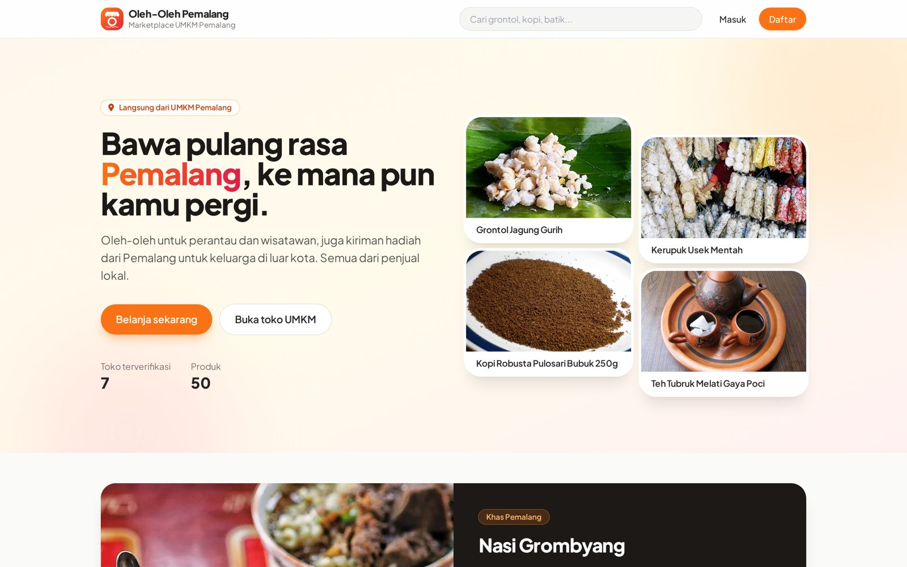
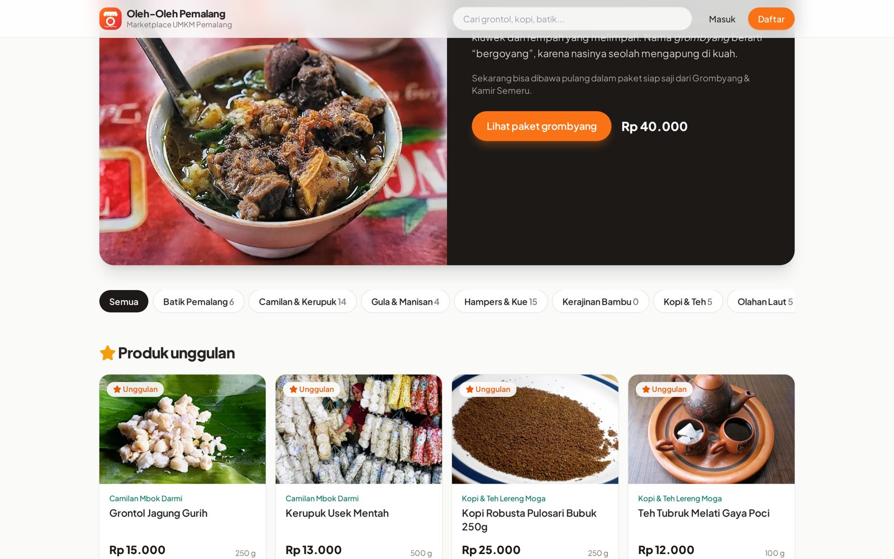
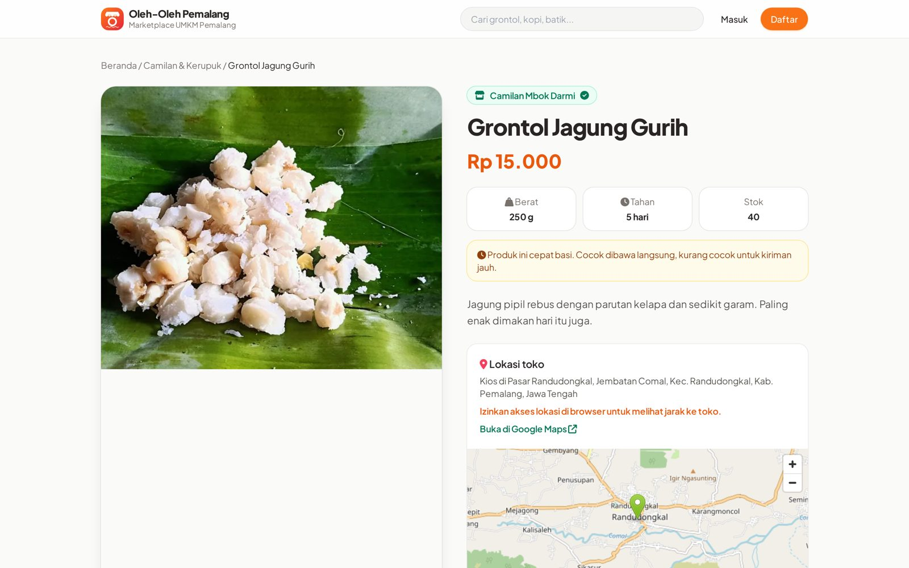
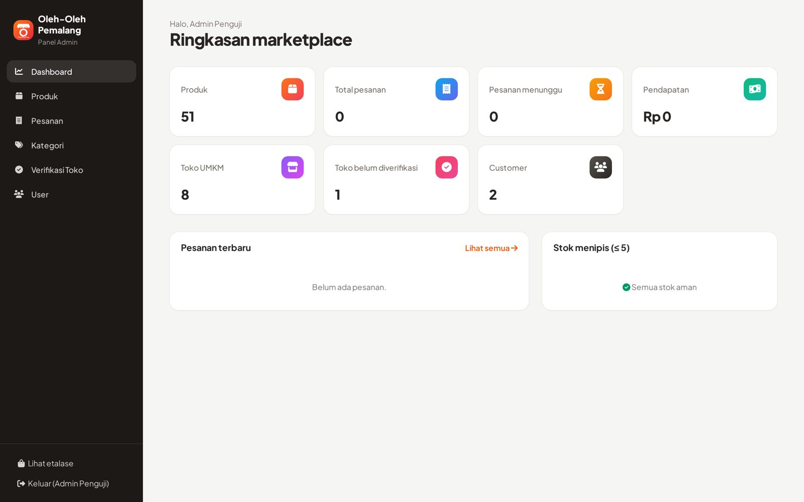
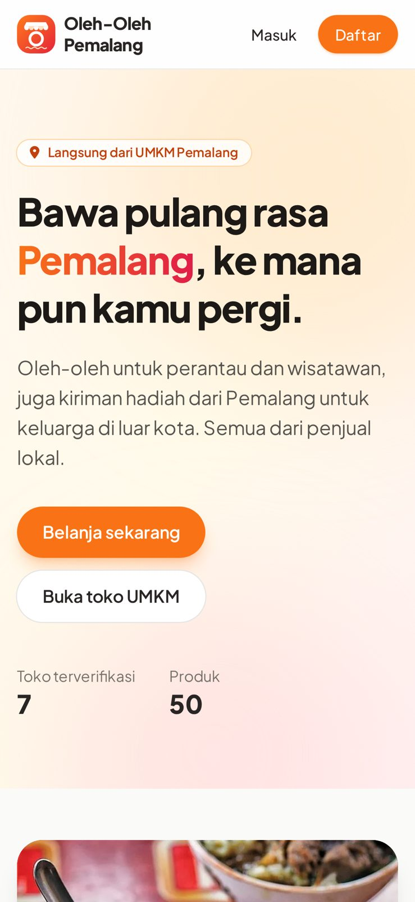

# Oleh-Oleh Pemalang

Marketplace oleh-oleh khas Pemalang. Beberapa UMKM bisa buka toko di sini dan jualan produknya, misalnya kerupuk, kopi, batik, dan gula aren. Pembeli tinggal pilih produk, masukin ke keranjang, lalu checkout.

Project ini dibuat untuk UAS Web Application Development (WAD04) Universitas Cakrawala. Pakai Laravel, MySQL, dan pola MVC.


## Demo Live

https://oleh-oleh-khas-pemalang-marketplace.wasmer.app

## Screenshot

| Beranda | Katalog |
|---|---|
|  |  |
| **Detail Produk** | **Panel Admin** |
|  |  |

<p align="center"></p>

## Fitur

- Daftar akun pembeli atau penjual, login, dan logout
- Penjual bisa buka toko, tapi tokonya harus diverifikasi admin dulu
- Penjual bisa tambah, edit, dan hapus produk, termasuk upload foto
- Pencarian produk dan filter per kategori
- Keranjang belanja, checkout, dan cek stok otomatis
- Kalau belanja dari beberapa toko, pesanannya dipisah per toko
- Riwayat pesanan buat pembeli, penjual bisa update status pesanan
- Dashboard berisi ringkasan data untuk admin, staff, dan penjual
- Lokasi toko ditampilkan pakai peta, lengkap sama jarak dari posisi pembeli

## Hak Akses

| Fitur | Admin | Staff | Seller | Customer | Tamu |
|---|---|---|---|---|---|
| Lihat produk dan toko | Ya | Ya | Ya | Ya | Ya |
| Keranjang dan checkout | Tidak | Tidak | Tidak | Ya | Tidak |
| Riwayat pesanan | Tidak | Tidak | Tidak | Ya | Tidak |
| Dashboard | Ya | Ya | Ya (tokonya) | Tidak | Tidak |
| Kelola produk | Semua | Semua | Milik tokonya | Tidak | Tidak |
| Kelola pesanan | Semua | Semua | Pesanan tokonya | Tidak | Tidak |
| Edit profil toko | Tidak | Tidak | Ya | Tidak | Tidak |
| Kelola kategori | Ya | Ya | Tidak | Tidak | Tidak |
| Verifikasi toko dan atur role | Ya | Tidak | Tidak | Tidak | Tidak |

## Akun untuk Dosen

Semua akun di bawah ini pakai password `uaswad#`. Login lewat halaman `/login`.

| Role | Email | Bisa ngapain |
|---|---|---|
| Admin | demo.admin@umkm.test | Verifikasi toko, atur role, kelola kategori, produk, dan pesanan |
| Seller | demo.seller@umkm.test | Pemilik toko Camilan Mbok Darmi, kelola produk dan pesanan |
| Customer | demo.customer@umkm.test | Belanja, checkout, lihat riwayat pesanan |

Ada juga akun lain dari data contoh dengan password `password123`:

- `admin@umkm.test` (admin)
- `staff@umkm.test` (staff)
- `customer@umkm.test` (customer)
- Seller: `kopi@umkm.test`, `batik@umkm.test`, `comal@umkm.test`, `grombyang@umkm.test`, `aren@umkm.test`, dan `laut@umkm.test`
- `bambu@umkm.test` (seller yang tokonya belum diverifikasi, buat nyoba alur verifikasi)

## Cara Menjalankan di Komputer Lokal

Siapkan dulu PHP 8.2 ke atas, Composer, dan MySQL.

1. Clone repo lalu masuk ke foldernya.

```bash
git clone <url-repo> 25110300028-iqbal-umkm_oleh-oleh_pmlng
cd 25110300028-iqbal-umkm_oleh-oleh_pmlng
```

2. Install package dan siapkan file `.env`.

```bash
composer install
cp .env.example .env
php artisan key:generate
```

3. Buat database kosong dengan nama `umkm_shop` di MySQL. Setelah itu isi `DB_USERNAME` dan `DB_PASSWORD` di file `.env` sesuai MySQL kamu.

4. Buat tabel dan isi data contohnya.

```bash
php artisan migrate --seed
php artisan storage:link
```

Atau, kalau mau, bisa juga import file SQL-nya langsung:

```bash
mysql -u root -p umkm_shop < database/umkm_shop.sql
```

5. Jalankan aplikasinya.

```bash
php artisan serve
```

Lalu buka http://127.0.0.1:8000 di browser. Pastikan ada koneksi internet, karena Tailwind CSS dan font-nya diambil dari CDN.

Untuk menjalankan test:

```bash
php artisan test
```

## Struktur Database

Database-nya punya 6 tabel utama:

- `users`: data akun dan role-nya
- `stores`: data toko, setiap seller punya satu toko
- `categories`: kategori produk
- `products`: produk, terhubung ke toko dan kategori
- `transactions`: pesanan, satu pesanan untuk satu toko
- `transaction_items`: daftar barang di tiap pesanan, beserta harga saat dibeli

## Struktur Folder (MVC)

```
app/Http/Controllers   -> controller (logika tiap halaman)
app/Http/Middleware    -> cek role user
app/Http/Requests      -> validasi form
app/Models             -> model (tabel database)
app/Policies           -> aturan siapa boleh ubah data apa
resources/views        -> tampilan (Blade)
routes/web.php         -> daftar URL
database/              -> migration, seeder, file .sql
tests/Feature          -> test fitur
```

Alurnya: request masuk ke route, dicek middleware, diproses controller, controller ambil data lewat model, lalu hasilnya ditampilkan lewat view.

## Keamanan

- Semua form pakai token CSRF
- Output di halaman di-escape supaya aman dari XSS
- Query database lewat Eloquent, jadi aman dari SQL injection
- Hak akses dicek pakai middleware role dan Policy
- Login dibatasi 5 kali percobaan per menit
- Upload gambar cuma boleh jpg, png, atau webp, maksimal 2 MB

## Catatan

Nama toko dan nama pemiliknya fiktif. Jenis produk, harga, dan lokasi toko diambil dari data asli Pemalang. Sumber data dan kredit foto ada di [docs/SUMBER-DATA.md](docs/SUMBER-DATA.md).
